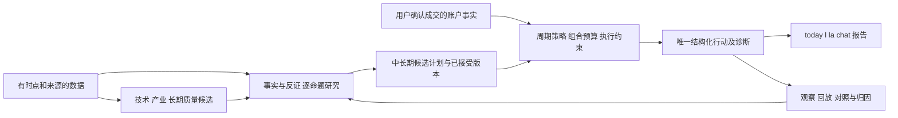

# 暮云长期路线与持续里程碑

T05共享等待与远端4cc3bf6增量限定接收；最终隔离全量3157 passed/0 failed/7 skipped/1 external deselected（265.49s），494项指纹稳定，原8保护项/109未跟踪保留。独立四退出4通过，静态审查限定PASS；G7/T05整体、真实MID及G4/V1仍未完成。

**唯一长期路线入口｜更新：2026-10-21｜当前限定接收：v0.8.42；本轮main整合，直接交付、无需PR｜原发布基线：v0.8.33｜目标基线：V1｜整体：未完成。**

**当前执行入口**：第十轮合同见 [iteration10/DELIVERY_PLAN.md](plan/fusion/iteration10/DELIVERY_PLAN.md)（本提交关闭 BUG-TUI-MARKUP / ISS-127；先已关 ISS-123 生产残余；不抢 T05/G7）；历史第九轮见 [iteration9/DELIVERY_PLAN.md](plan/fusion/iteration9/DELIVERY_PLAN.md)；ISS-117原已验范围保持接收，行动说明与独立止盈抑制尾项已按P2补齐并验收，不重新开工。原实施范围和验收记录保留在现有[S2AC计划](plan/fusion/signal_authority_review/S2AC_FINAL_CLOSEOUT_TASK.md)与[S2AC验收](plan/fusion/signal_authority_review/S2AC_ACCEPTANCE.md)，只作历史依据。

**2026-10-20历史main整合**：v42限定观察及此前各批接收边界保持；已完成本轮main整合验收与双仓库收尾。最终隔离全量3091 passed/0 failed/3 skipped/1 external deselected，2条既有测试转义警告（399.29s）；486项源码/测试/公开材料/隔离器指纹起止一致，6项保护hash与知识库集合不变。network 1011、subprocess 12、real_state 2次尝试均被守卫阻断。 原账户/知识库脏改及109个未跟踪文件不提交。真实MID、历史行业/PIT、ROE、现金持续性及G4/V1仍未完成，后续只按既有G/T路线安排，不因工具接通自动启动v43。

本文件回答“最终做成什么、现在在哪、还差什么、什么时候算完成”。每批实现与审批状态见 [STATUS](plan/fusion/STATUS.md)，当前审批见 [R15](plan/fusion/iteration9/R15_ACCEPTANCE.md)，下一执行窗口见 [第九轮](plan/fusion/iteration9/DELIVERY_PLAN.md)。F/R/J/K/L/M/N/O/P 是实施批次，下面 G0–G8 是稳定的产品里程碑，两者不可混用。

## 一、长期期望与范围基线

沿用用户已确定的目标，来源为 [融合愿景](plan/fusion/README.md)、[融合设计](plan/fusion/DESIGN.md)、[总体工程架构](plan/ARCHITECTURE.md)及2026-10-01本会话要求。下表是既定目标的归纳；具体阈值尚待验证的部分不伪称用户已拍板。

| 需求 | 理想能力 | 最终能观察到的行为 | 承接 |
|---|---|---|---|
| R01 中长期并存 | 中期研究催化剂与盈利兑现；长期研究企业质量、现金创造、估值与失效条件 | 两种周期各有合法正例与反例；亏损中期不会自动变长期；一个实际持仓主意图 | G3/G4 |
| R02 三方融合 | 笨韭提出产业/企业假设，技术与技能引擎负责广泛筛选、择时和纪律，AI提取事实、反证与解释 | 一个带条件的终态结论，能追到证据；不把三份意见重复计票 | G2/G3/G5 |
| R03 清楚的日常体验 | today先处理持仓和重大风险，l统一单股，la/批量接续，bz/scan保留专家入口 | 能回答做什么、为什么、什么条件改变；细节可展开，重大风险不被简洁界面隐藏 | G2 |
| R04 研究持续演进 | 候选→原文→核验→命题→计划→接受→复核→归因 | 新材料形成候选、旧接受态不被覆盖；检查点有证据及用户风险确认；重启可找回 | G1/G3/G4 |
| R05 账户与组合约束 | 建议和真实成交分开；数量、现金、成本、可卖份额与组合预算一致 | 部分成交、异常恢复、资金不足、停牌等情境下事实不丢、不重复、不假精确 | G1/G5 |
| R06 有价值的机会发现 | 技术/产业/长期质量召回，去重后在有限研究预算内排序 | 来源、漏选/误选、增量覆盖与费用可比较；不是仅增加扫描数量 | G5/G6 |
| R07 有依据的AI和知识检索 | 公司事实与方法知识分开；来源、时点、反证可审计；缓存避免重复付费 | 检索质量/提取准确性用独立集验证，缺数据如实说；解释不能改写底层动作 | G3/G4/G7 |
| R08 效果可验证 | 正确性、可用性、投资效果分别验证，支持历史回放与前瞻观察 | 可复现实验与失败记录；只有相应周期的证据过门才晋级 | G6 |
| R09 工程更可靠精简 | 模块化单体、共享业务入口、清晰依赖、可恢复存储、可诊断外源 | 新功能改动面缩小；跨端语义一致；卡死、内存、耗时和请求量有基线及改善证据 | G7 |

范围边界：A股研究与决策辅助；不接自动实盘下单。REPL是首要验收入口；已有chat/Web/TUI须保持兼容并逐步共用语义，不在本基线主动重做视觉界面。同股多意图分仓、微服务、多Agent产品平台均未纳入V1；新增需求需明确影响和取舍。Codex额度守护是独立开发工具方案，用户尚未要求部署，不算投资产品交付。

## 二、基本架构：贯穿每轮的固定框架

保持现有Python单体；复用现有服务并明确数据所有权：账户事件拥有成交事实，原文/快照拥有证据，AssessmentStore拥有评估，计划库拥有精确接受版本，展示只投影终态。可用性、计算成功、事实核实、命题成立、用户接受、可执行、实验有效分别判定，不相互替代。

工程重构围绕这些边界推进：先验证语义，再收拢重复入口，最后删兼容壳。不能以移动文件或减少行数代替收益证明。

## 三、持续里程碑总表

状态：`已验收`必须有指定范围的独立证据；`部分完成`含已实现和未达门槛项；`待实施`没有实现；`证据受阻`不能算完成。当前没有整体完成的产品里程碑，不以批次测试数量计算百分比。

| ID | 能力里程碑 | 当前状态（2026-10-17） | 已有基础 | 达成标准与关键剩余 |
|---|---|---|---|---|
| G0 | 目标、基线和长期路线可持续恢复 | 框架已建立；随批维护 | 早期ADR、验证规范、本文件、R15 | 需求都有里程碑和验证；每次审批同步状态、证据和下阶段；读入口无冲突 |
| G1 | 事实与账户可信 | 指定账户事实业务读出口已通过，整体部分完成；ISS-126 写侧+读侧（BUG-FINITE / BUG-FINITE-READ）已合入：新写入拒非有限，旧毒事件重放隔离为 PARTIAL | P0历史、同请求ctx及原计划、v35显式快照结构边界；7de1e59 写侧 + 本提交读侧 | T01登记范围关闭不代表全部成交/并发或组合事实完成；其余按G5与验收范围继续；本读侧卡为 iteration10 队列续作，不替代 T04/T05/G7 |
| G2 | 统一的日常工作流 | M2有限查询、T01登记业务读出口已验 | l/la只读研究、today、chat、行业、TUI/Web指定账户读取 | 完整跨端packet/研究视图与T02/T04仍待；管理投影明确豁免 |
| G3 | 中期证据研究与复核闭环 | 本批工程合同通过；真实样板未成立 | cv6/binding_v4、完整条件、幂等存储、综合method、公开链及v15报告隔离已验 | 002957官方完整段为EXCERPT，MID UNESTABLISHED；还缺完整三命题支撑。不改原文/重复计证，未来新能力独立合同与版本化 |
| G4 | 长期企业研究与估值能力 | 部分完成；v37至v42限定范围逐步接收，长期判据与数据资格未完成 | LONG模板、既有两期规则、L3负债率六点原件、cash_materials安全进入及只读回读 | v42仅接收当前SSE转述C15条件下的1组2期现金观察；历史行业/PIT、ROE、现金持续性仍UNKNOWN，不能称长期TRUE/MID。G4整体不关闭，不得填values_by_period激活旧TRUE |
| G5 | 候选召回、组合分配与成交约束 | 部分完成 | 三路候选/因子登记、预算求解、事件账本 | 固定预算下召回增益；同组合快照分配；净现金/NAV/价格时点/日期化交易规则齐，未知则条件化；逐股数量与组合上限一致 |
| G6 | 可比较的观察与效果晋级 | v14历史及v15本批工程合同冻结；真实观察与效果待办 | 同源记录、完整版本门与捕获时点回放已验 | 工程冻结不代表真实MID、策略默认晋级或投资效果，真实样本按预注册与前瞻周期推进 |
| G7 | 必要重构、性能、诊断与多入口一致 | T01登记范围和T04配置小步通过，整体未完成 | 共享请求事实；9配置消费者迁移、零配置反依赖、4有意CLI桥保留 | T02/T04剩余边界、T05性能、T06质量、T07便携与实际效果按既定合同继续 |
| G8 | V1整体结项与维护移交 | 待实施 | 历史知识资产与回滚机制 | G0–G7按范围过门；必要缺陷/优化/重构清零，用户场景与运维演练通过，文档/依赖/迁移可复现；保留维护流程，不再无目标增加迭代 |

## 四、推进路线与依赖

1. **历史窗口：v42限定接收与Git收尾。** Codex管理审批/DSH实施的接续身份已配置，本次只完成远端增量整合、文档和交付；不启动G7/T05候选或v43。已接收的C15条件化当前观察不追认历史行业/PIT；ROE、现金持续性、真实MID与G4整体仍未完成。v39-v41范围保持，T01/T04限定接收保持，T07旧负债率六点的supplier.raw、更正检索与PIT仍缺。
2. **后续能力窗口：G4/G5**。先核定字段、期间和行业适用性，再设计命题与估值情景；波次B只做已有消费者的字段，先验证一类非金融企业。
3. **贯穿窗口：工程收敛与成本（G7）**。沿已进入的业务边界逐条归并；先量基线，确认收益再优化，不一次重写main或所有持久化模块。
4. **效果窗口：前瞻观察和分周期晋级（G6）**。真实时间可与工程工作并行，但工程或模拟数据不能代替可比较的前瞻样本；保留未完成状态。
5. **结项窗口（G8）**。复验全部需求映射与必要债务清单；确认未来新增方向另起基线，不无限延长V1。

## 五、必要优化/重构台账（不会丢在某轮附录里）

| 固定项 | 依据 | 归属与启动条件 | 关闭证据 |
|---|---|---|---|
| T01 账户事实统一读出口 | ISS-116已登记业务读取范围限定完成 | G1/G2/G7；v35独立边界17用例+10格、290目标/2301全量；显式快照/精确集合尾项关闭 | l/la/chat/today/行业/TUI/Web登记范围有证据；管理pos豁免，不扩为全部成交/并发/研究视图 |
| T02 研究与计划命令归并 | B1问题明确，M2有限l/la只读接线已验收 | G2/G3，后续入口整合按依赖实施 | 查询不写研究；候选不替换接受态；l/la共用视图；不把run(capture=False)当只读 |
| T03 终态/观察共用字段语义 | 两臂规范包/版本门、O1时点与O2 LONG通过；P0/P1/P2限定补修独立通过 | G6，shadow_v14观察合同已冻结；表v4保持 | ctx/state/packet/同源shadow/公开消费者一致；失败保持UNKNOWN；真实观察及效果仍未完成 |
| T04 UI反向依赖与大函数拆分 | 配置入口归位小步已验，整体部分完成 | 原盘点12处非CLI导入main；v35迁移9处配置调用，现保留4个有意命令/规范化桥 | 保留兼容wrapper，不按剩余数量拆桥；后续必要边界先验证，不声称性能或大函数拆分完成；2026-10-21第十轮T04-A把持仓确认数量路径的账本编排下沉`account_service.confirm_quantity_from_proposal`（c7fb92b，黄金输出逐字锁定），T04-B把TUI加仓与chat删仓改调`portfolio.add_position_checked`/`remove_position_checked`并修TUI假成功（03cab94，ISS-124）；T04-C已合入：chat add/plan/overweight改调prepare_trade_plan_draft/activate_overweight_checked；T04-D本提交合入：CLI pos plan --update再抽为prepare_generate_or_update_plan（Y/n仍在CLI） |
| T05 外源超时、缓存、批量与资源成本 | ADR02/04、C2/C3；既有装配重放基线仅用于比较 | G7；v36缓存时点/原子写和v41专用取证退出界实际修复已验，整体未关闭；3个共享helper及新增robust入口自身退出等待已通过，远端扫描批等待/缓存/日期主体边界已限定接收；原剩余4个旧并行executor站点已于2026-10-21第十轮T05-D用daemon并行helper修复，4个专用退出反例先红后绿（commit `ac6ce8a`，全量3184 passed/0 failed/11 skipped/1 deselected（656.61s）） | 限定包装器与旧并行入口退出界均已修复；晚到写缓存副作用与Baostock会话重叠继续待办。保留降级/重试/缓存语义；成本与性能改善另须证据，不以探针计数替代 |
| T06 AI/RAG质量与评分口径 | C4/C6及E5；已有独立工具不等于效果完成 | G3/G4/G7；冻结独立集，付费另授权 | 引用正确性/检索质量/提取准确率及成本对照；不自评自证，不擅改legacy公式 |
| T07 数据证据便携与版本化 | L3脚本/清单已跟踪，raw/mapped已分离；2026-10-16再次6/6离线复验，000002_2024Q2来源URL已按逐字节一致的官方PDF补记 | G4/G6部分接收；供应商raw、更正检索、PIT、异机获取与旧登记迁移仍待办。download_log仍无该半年报行。显式重建仅在file_hash一致时保留已记录source_url，默认覆盖交付清单仍不做。负债率原件不证明现金语义 | 原件可获取且可离线重建；修订追加不覆盖；测试不能写真实账户；长期范围按既有G7/T07门槛验收 |

以上是V1已知必要工作。新发现必须说明影响哪个R/G/T、严重性、证据和优先级；没有用户收益或可验证风险的“顺便优化”不加入必做清单。

## 六、每一轮的设计与验收规则

**事实调查 → 最小反例/基线 → 小范围方案或原型 → 设计验证 → 实施 → 独立复验 → 更新本表。**

- 设计状态单列为“未验证 / 原型验证 / 实现复验 / 真实效果验证”，后一级不能由前一级代替。不能凭一张任务卡宣称设计有效。
- 每张可开工卡必须写：对应R/G/T、消费者路径、用户收益、修改边界、前置、正常/失败/迁移、反例和验收命令、资源上限、停止与回滚条件。
- 一次只深入当前依赖已经满足的少量卡。下一窗口只列待验证问题；不得借额度充裕扩大成没有结束条件的研究。
- 固定合同设计见[第六轮设计验证](plan/fusion/iteration6/DESIGN_VALIDATION.md)：19场景与B1/B2基线；第七轮以[R13的17条产品对照探针](plan/fusion/iteration7/ACCEPTANCE_PROBE_RESULTS.json)定位既有合同接线缺口。原型只证明合同可区分正反例，不代表生产实现或投资效果。
- 用户使用反馈验证“是否能做对下一步”；收益验证遵守[VALIDATION](plan/fusion/VALIDATION.md)，提前冻结指标、数据范围、比较基线和成本。门槛未冻结前不宣布效果成功。

## 七、什么叫“所有该做的都完成”

V1结项必须同时满足：R01–R09都有验收证据；G1–G7达到明示支持范围；没有未处理的阻断缺陷；T01–T07的必要条款关闭；安装/迁移/备份恢复/异常退出/跨入口回归可复现；文档与代码一致；默认策略晋级有对应周期效果证据，或用户明确接受较窄发布范围。

数据不足、未授权实验、等待真实观察均是**未完成**，不得用“延期”自动清零。可选扩展仅经明确范围决策移出V1。工程版本可以先交付，但整体基线保持未完成。达到上述标准后转维护，不为消耗额度制造新任务。

## 八、维护职责与更新记录

用户决定目标与重大范围取舍；当前Codex架构师维护本文件并作验收，实施Agent更新实现账本与证据。共享文档不自动改变阅读者身份。每次交付、审批、发现阻断或范围变化，必须同步：**本表对应G/T → STATUS当前动作 → RESUME恢复指针**。历史报告保留日期，不复制过期结论到当前入口。

本文件在每次实际工作会话持续更新；未配置后台任务，不承诺聊天停止后自动监控实施进度。恢复先读本文件和STATUS，比较HEAD/工作树/指纹，再继续未完成依赖。

| 日期 | 变化 | 证据/决定 |
|---|---|---|
| 2026-10-01 | 从批次清单提升为V1长期需求/能力里程碑；修正STATUS总表与恢复记忆漂移 | 用户本轮要求；R11独立复验；第五轮仅启动已验证边界问题 |
| 2026-10-01 | R12审批L系列：281目标绿、六点原件复验；入口引用等范围接收，W1/W2阻断冻结 | M0/M1启动；M2只读接线设计19场景原型通过、待前置；整体未完成 |
| 2026-10-01 | R13审批M系列：381目标绿、17合同场景15红/2绿；原W1投影存在/W2日期范围通过，X1/X2/X3待补 | N0账户消费/N1规范观察与版本/N2时点；M2仅正常只读原型接收，K1不冻结；整体未完成 |

- 2026-10-02 R14：N批分项接收，423目标绿、17旧反例全绿；5新红断言归为Y1–Y4，M2原型25断言接收。K1未冻结/M2生产未放行；O0–O2承接G1/G2/G4/G6与T01/T03，整体未完成。

- 2026-10-02 R15：O1/O2接收，O0部分接收；33文件462绿，13合同项9绿4红（三组Z1–Z3）。K1未冻结/M2未放行；P0/P1 READY，M2只读接口DESIGN_READY。正常RATIO_ONLY无行为变化可接收；不强制迁移真实账户。

- 2026-10-09–13 ISS-117：A01–A13审查发现弱证据越权风险；原S2a/S2b/S3已实施并自检，已验范围继续接收。专项独立只读复核未发现当时范围内当前可达确定P0/P1阻断，reviewer未运行测试；2026-10-12离线全量1818 passed、0 failed，10-13展示映射增量补验72 passed、0 failed，7项保护哈希及知识库集合不变。该结论不覆盖新发现的行动说明与独立止盈抑制尾项。
- 2026-10-13 修复前P批基线：原35文件485 passed（138.73s），R15原7探针全过；另三轮探针共19个不同场景7通过/12失败，分为15场景7/8、3场景0/3、1场景0/1，非单次19项运行。该记录只作修复前证据。
- 2026-10-14 v0.8.31验证与裁决：全量1962 passed、2 skipped、1 external deselected、0 failed（338.26s）；定向131 passed、0 failed（18.55s，原19探针全绿），另一次110 passed不相加。网络785与子进程2次尝试均阻断，成功0、真实状态读取0；7项保护hash及知识库集合未变。4个核心E2E场景覆盖live/模拟bar真实Orchestrator关键层到evidence/shadow/actioncard，固定技能/外源替身，AI/Event/EntryExit未开启；券商执行与投资效果未验。独立Sol/high复核PASS，批准限定P0/P1/P2补修及shadow_v14合同冻结、无剩余已证实P0/P1；本次行动说明/独立止盈抑制尾项关闭，不重批原已接收范围。M2当时获准实施；K1已按v14冻结，capture_only不变。
- 2026-10-14 v0.8.32 M2有限生产只读接线最终`ACCEPTED_READONLY`：全量1997 passed、0 failed、2 skipped、1 external deselected（334.44s）；785次网络与2次子进程尝试均被拒，真实状态读取0，7项保护hash及知识库集合不变。独立Sol/high核验7项当前源码/测试SHA一致，确认有限只读接线最终PASS且无本范围阻断。6文件68项定向结果与全量分开报告，不累加。具体日志见iteration9/FULL_TEST_RESULTS_P.txt和TARGETED_TEST_RESULTS_P.txt的M2标头。K1/shadow_v14冻结、capture_only/default不晋级；下一步G3完整MID VALID样板。
- 2026-10-14 v0.8.33 T01 today共享账户卡片：4文件55 passed/0 failed（5.86s），全量2013 passed/0 failed、2 skipped、1 external deselected（315.85s）；网络785、子进程2次尝试均阻断，真实状态读取0，7项保护hash与知识库集合不变。独立Sol/high核对5项SHA与当时源码一致、55/2013日志匹配，有限today只读接线`ACCEPTED_READONLY`，无本范围P1。定向日志旧M2标头与COMMAND=today不符；属于T01回归，不重批M2。后续G3状态见本文件当前段与[RESUME](plan/fusion/RESUME.md)：正文句子绑定已写入未提交工作树，test_g3_fact_scope.py 35 passed，已改未验收；148项局部target不代表整体验收。

- 2026-10-16 Codex分工补修验收（测试2026-10-15）：全量2261 passed、0 failed、2 skipped、1 external deselected（201.01s）；23文件定向547 passed、0 failed（25.22s）；独立限定复核通过，cv6/binding_v4及shadow_v15工程合同冻结，行业与TUI/Web指定账户读出口接收。真实002957公开研究重启身份一致但仍UNESTABLISHED，G3/T01/V1未完成；已发布v33与未提交v34分开，capture_only/default保持。证据只维护现有第九轮R15/index/原始日志。

- 2026-10-16 v0.8.35：16文件290 passed（107.26s），全量2301 passed/0 failed/2 skipped/1 external deselected（342.60s）；独立Sol/high最终限定PASS，关闭ISS-116登记业务读取范围，接收T04配置小步。7保护hash及知识库集合不变；下一G4原型与Grok五小时队列均只维护现有第九轮计划。未发布/真实研究与效果边界保持。
- 2026-10-16 三分钟接续曾暂停：指纹、G4原型与43项矩阵、T07一条哈希相符URL均已入账。本运行时不能派出Sol/high，也不能伪造supplier.raw、更正检索或PIT；无生产源码差异，不重跑v35全量2301。G4保持IMPLEMENTED_AWAITING_INDEPENDENT_REVIEW，T07未关闭。
- 2026-10-16 T07重建保留：显式路径在file_hash一致时留下000002_2024Q2来源URL，hash不符则丢弃。L3守卫10 passed、0 failed（42.31s），网络/子进程/真实状态尝试0，7保护hash与知识库集合不变。未默认覆盖evidence_manifest.json，未运行verify_and_register.py，未改G4原型。清单SHA256为`a47ae8287be9d13f2ed5ede0d8d5e353b5831684a43d2087416f31ae587e8344`。T07未关闭。T05已积累mock/临时路径只读基线与计数探针；不是实网、性能改善或产品修复，T05未关闭。原始逐项结果保留在TARGETED日志与Git历史。

- 2026-10-16 v0.8.36：全量2730 passed/0 failed/2 skipped/1 external deselected（224.53s），独立缓存306目标/8并发失败探针分别PASS；G4补期末门、49正式/2独立反例通过，T07工具5目标含6点复算限定PASS。缓存时点与原子写实际修复完成，不声称性能提升；18镜像文件合为196行矩阵，剩余T05 84文件；真实MID/投资效果与生产G4边界保持。

- 2026-10-16 v0.8.37：v0.8.37归档观察展示本批限定验收通过，未commit/tag/push；最终全量2749 passed/0 failed/2 skipped/1 external deselected（361.44s），5文件101定向及独立文本增量20项分别通过。 原型算法单份提升，侧栏库存与资格分层，新增19项实际接线/真实性/生命周期回归；文本引用缺口先红补齐。7保护hash和知识库集合不变，445项源/测试指纹稳定；仅资料展示接收，下一原件/语义/行业资格尚待核定。

- 2026-10-16 v38：G4真实材料盘点触发新增财务采集身份前置补修；Astra校准、Sol实施与独立复核，2844全量通过。供应商/字段/综合method及旧接受态保持；真实现金/行业资格仍待核，执行仅见第九轮。

- 2026-10-17 v0.8.40：`ACCEPTED_LOCAL_CASH_NUMERIC_CONSISTENCY_ONLY`，未提交发布；父9文件172 passed/0 failed（42.55s），最终全量2942 passed/0 failed/2 skipped/1 external deselected（396.40s）。456项源码/测试/材料指纹前后稳定，7保护hash与知识库集合不变；独立8组8 passed（10.67s），另原guard两正式文件98 passed（19.09s）。独立真实numeric worker仅对600519原PDF执行3次，服务对象重建回读通过；没有另起OS产品进程，也未声称实际超限PDF逐项运行。全量1005网络/2子进程尝试阻断、real_state 0；父目标235网络尝试阻断，子进程/真实状态0。只接收Q1合并NP/CFO及六位工程比率的本地数字一致性，不晋级来源真实性、语义/FACT、公开时间、PIT、行业、ROE或长期逻辑。v40历史范围保留，不覆盖为v41结果。
- 2026-10-17 v0.8.41：`ACCEPTED_CURRENT_OFFICIAL_CASH_FIELDS_ONLY`，未提交发布；父10文件224 passed/1 skipped（45.81s），独立8组8 passed（4.01s），原guard两正式文件105 passed/1 skipped（21.53s），最终全量2994 passed/0 failed/3 skipped/1 external deselected（379.53s）。458项源码/测试/材料指纹起止稳定，7保护hash/知识库集合不变；network 1005、child 12均阻断、real_state 0；进程退出专用case最终SHA复核1 passed。仅接收当次官方原件核定的NP/CFO字段资格及限定展示，不证明历史公开、供应商通用语义/FACT、PIT、行业历史资格、ROE或长期命题；真实MID仍NO_VALID。v41历史结果保留，不覆盖为v42结果。
- 2026-10-17 v0.8.42：`ACCEPTED_CURRENT_CONDITIONAL_CASH_OBSERVATIONS_ONLY`，未提交发布；父12文件328 passed/1 skipped（29.05s），最终全量3049 passed/0 failed/3 skipped/1 external deselected（229.65s）。460项源码/测试/材料指纹稳定，7保护hash/知识库集合不变；network 785、child 12均阻断、real_state 0。独立8组按轮次7 passed+1临时夹具错误（4.04s）后仅重跑受影响组1 passed（2.19s），实际worker共2次；原guard两正式文件107 passed/1 skipped（6.03s），产品退出专用case最终SHA复核1 passed。真实PDF/SSE各一次，产1个当前条件化组2期，行业仅当次SSE转述C15非金融。历史行业/PIT、ROE、现金持续性仍UNKNOWN，真实MID NO_VALID、G4整体/V1未完成。批次完成后暂停等待新指派。
- 2026-10-20 原生DSH只读协作限定通过（非产品迭代）：同session分析/追问/追加量化自评三请求完成，原两轮21/21工具结果成功，用户认证后代传0次；主控纠正方案边界与自评缓存分母。初版27项本地回归另记，未称全功能或节省费用。用户明确重大改动验收后集中commit+push，当时v31–v42快照曾由`codex/v42-native-collab`交付，后按用户要求更正为main直接集成；7项远端增量由本轮最新记录承接。量化及便携夹具复验见第九轮计划末节，不计G7修复、v43或产品整体完成。

- 2026-10-22 第十轮 T04-D（CLI pos plan --update 再抽）合入：prepare_generate_or_update_plan/`accept_plan_update；CLI 薄封装保留 Y/n；定测	est_t04d_plan_update_prep；不绑 G7/v43；下一张候选 T05-G7 剩余（不抢道）。
- 2026-10-21 第十轮 测试写报告目录隔离（ISS-123 残余）合入：conftest session 隔离`evidence._REPORT_DIR` + 仓库分析报告/analysis 文件名守卫；定测`test_report_dir_isolation` 4 passed；全量 3323 passed/0 failed/11 skipped/1 deselected（339.82s）；不绑 G7/v43；下一张候选 CLI pos plan --update 再抽；T05/G7 不抢道。
- 2026-10-21 第十轮 BUG-CASH-WRAP（ISS-128）合入：现金材料回执断言适配 Rich 折行（捕获 Console 补 height 固定宽度；断言去换行）；定测 `test_cash_material_intake.py` 45 passed；不改生产折行；下一张候补测试写报告目录隔离（`evidence.py` `_REPORT_DIR`）；T05/G7 不抢道。
- 2026-10-21 第十轮 BUG-TUI-MARKUP（ISS-127）合入：分析面板失败提示统一 `rich.Text`，消除字面 `[red]`/`[green]`；定测 `test_bug_tui_markup.py` 4 项先红后绿；相关 TUI 12 passed；不捆绑 BUG-CASH-WRAP；下一张候选测试写报告目录隔离 / BUG-CASH-WRAP；T05/G7 不抢道。
- 2026-10-21 第十轮 ISS-126 读侧（BUG-FINITE-READ）合入：Claude 在 BUG-FINITE 写侧 `7de1e59` 后留在 iteration10 队列的下一张 P1（非平行新轨）。重放隔离非有限事件→PARTIAL；nan 成本账本可读可再写；today/NAV 未知语义。本轮 Claude 已接受主线（T05-D/BUG-OW/BUG-IDX/T04-A/T04-B/BUG-FEE/写侧）保持；T04-C 已于同日合入（草稿编排下沉+chat去CLI桥）；下一张见候选（RAG CWD/BUG-TUI-MARKUP等）；T05/G7 剩余（晚到缓存、Baostock、真实 MID 等）仍按本表推进。证据见 `tests/core/test_bug_finite_ledger.py` 35 passed 与 plan/fusion/iteration10/DELIVERY_PLAN 执行记录。
- 2026-10-20 main整合收尾：`ACCEPTED_MAIN_INTEGRATION_SCOPE_ONLY`。最终隔离全量3091 passed/0 failed/3 skipped/1 external deselected，2条既有测试转义警告（399.29s）；486项源码/测试/公开材料/隔离器指纹起止一致，6项保护hash与知识库集合不变。network 1011、subprocess 12、real_state 2次尝试均被守卫阻断。 NAV纯查询与pipeline数量边界补修；双仓库分开交付。具体指纹、分轮失败及限制见第九轮最新验收，不重算历史各批数字。
